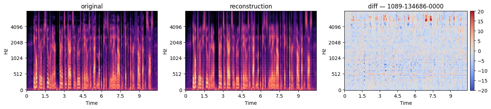
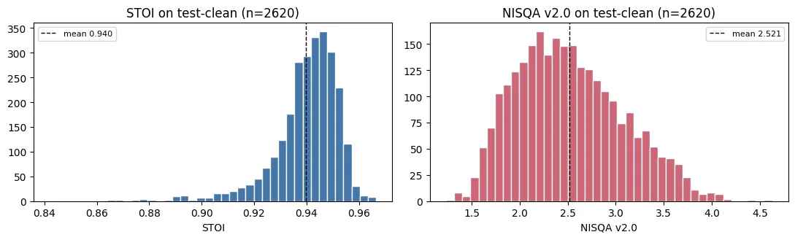
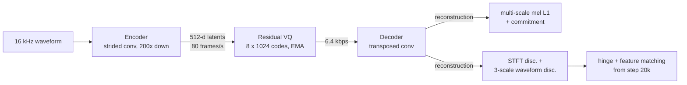
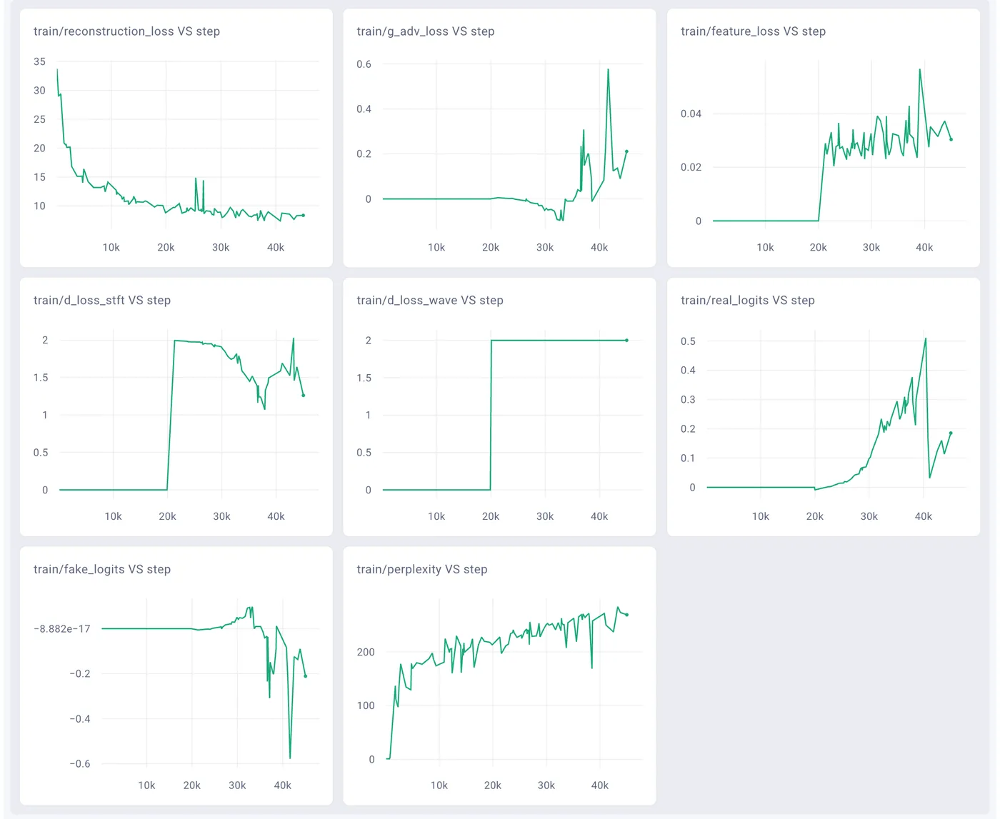
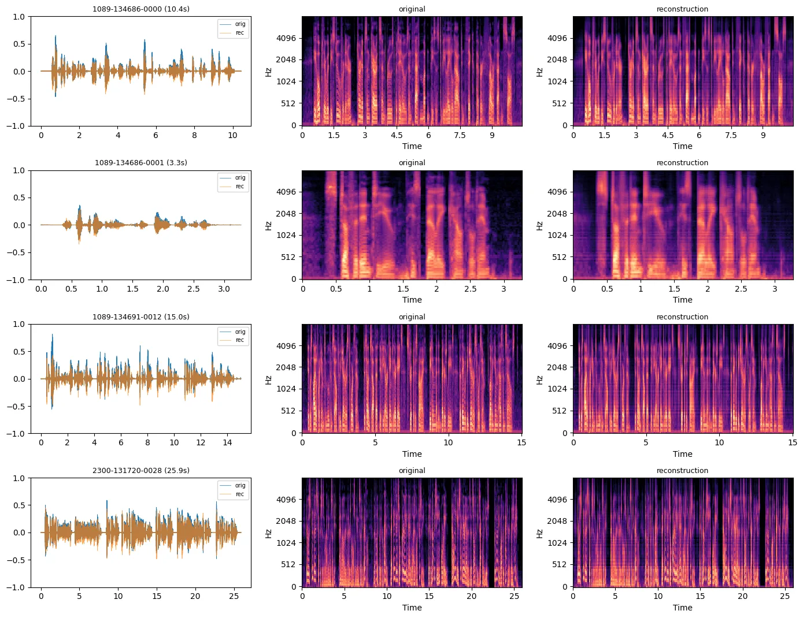
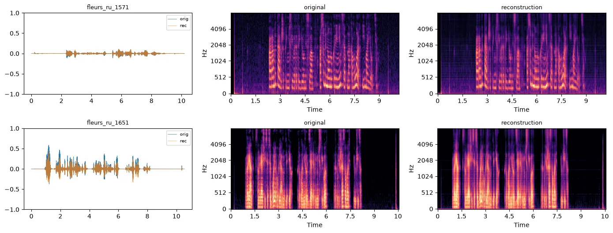

# Neural Audio Codec

A SoundStream-style neural speech codec that I implemented and trained from scratch in PyTorch. It compresses 16 kHz speech into 6.4 kbps of discrete tokens (8 × 1024-entry residual VQ) and decodes them back into a waveform.

<p align="center">
  
  <br>
  <sub>LibriSpeech <code>test-clean</code> utterance 1089-134686-0000: original, reconstruction at 6.4 kbps, and the log-mel difference in dB. Most of the error is in the upper mel bands. Figure from <a href="notebooks/analysis.ipynb"><code>notebooks/analysis.ipynb</code></a>.</sub>
</p>

**[Comet report](https://www.comet.com/tolya-ho/neural-audio-codec/reports/bjGhn710Lq4THJBv3eqoCNKnE)** (public, no login: curves, audio, ablations) · **[Checkpoint on Hugging Face](https://huggingface.co/tolyho/soundstream-librispeech-16khz)** · **[Colab demo](https://colab.research.google.com/github/tolyaho/NeuralAudioCodec/blob/main/notebooks/demo.ipynb)** · [Analysis notebook](notebooks/analysis.ipynb) · [Listen to reconstructions](#listening-to-the-results)

The Comet report is the full write-up: problem framing, every experiment in the order I ran it with curves and audio, ablations, the GAN vs no-GAN comparison, per-step loss terms and codebook perplexity. The analysis notebook adds qualitative in-domain, external English and Russian checks plus quantitative metrics.

## Results

All rows are evaluated on full LibriSpeech `test-clean` (n = 2620). STOI is reference-based intelligibility (0 to 1). NISQA v2.0 is a reference-free naturalness score on a 1 to 5 MOS-like scale.

| model                                          |   STOI |  NISQA |
| ---------------------------------------------- | -----: | -----: |
| reconstruction only                            | 0.9144 | 1.9335 |
| two-stage STFT-GAN (from reconstruction)       | 0.9317 | 2.3278 |
| scratch EMA RVQ + delayed STFT/wave GAN (final)| 0.9399 | 2.5212 |

Full precision: STOI `0.9398752048725391`, NISQA `2.5212083049857887`.

- The final row is reproducible from the per-utterance scores committed in [`data/metrics_final.json`](data/metrics_final.json). The first two rows come from the [Comet report](https://www.comet.com/tolya-ho/neural-audio-codec/reports/bjGhn710Lq4THJBv3eqoCNKnE) (sections 3.1, 3.2 and 5).
- The reconstruction-only and final runs are 45k steps each. The two-stage run fine-tunes the reconstruction checkpoint for another 45k steps.
- Per-utterance spread for the final model: STOI std 0.013 (min 0.842), NISQA std 0.556 (range 1.23 to 4.63).

<p align="center">
  
</p>

The adversarial stage is what moves NISQA. The reconstruction-only model already keeps words, speaker and timing (good STOI), but it sounds dull because mel L1 does not reward high-frequency texture. Adding the GAN late and keeping it weak improved both metrics. Starting the discriminator at step 0 failed, and stronger discriminators lowered both metrics (see the ablation in the report).

## The problem

A neural codec has to fit speech into a small, fixed bit budget and still decode it into audio that is intelligible and sounds natural. With reconstruction losses alone the output is intelligible but muffled. Adversarial losses add texture back, but they easily destabilise training and can hurt codebook usage. The task was to reproduce the [SoundStream](https://arxiv.org/abs/2107.03312) recipe end to end at 6.4 kbps and find a training schedule that gets both.

## What I built

- **Encoder / decoder** (`src/model/`): SEANet-style strided 1-D conv stack with dilated residual units. Strides 2·4·5·5 give 200× downsampling, so 80 latent frames/s of 512-d vectors. The decoder mirrors it with transposed convolutions. The codec has 14.4 M parameters.
- **Residual vector quantizer** (`src/model/rvq.py`), written from scratch: 8 stages × 1024 codes, EMA codebook updates, straight-through estimator, commitment loss, and per-stage codebook perplexity for monitoring. 80 frames/s × 8 stages × 10 bits = 6.4 kbps.
- **Losses** (`src/loss/`): multi-scale mel L1 (FFT sizes 64 to 2048) plus commitment loss, then hinge adversarial loss plus feature matching.
- **Discriminators** (`src/discriminators/`): a complex-STFT discriminator (real and imaginary channels) and a 3-scale waveform discriminator.
- **Training** (`scripts/train.py`, `scripts/train_gan.py`): Hydra configs, a delayed and ramped GAN schedule, discriminator updates every N steps, resumable checkpoints, and Comet logging of every loss term, the logits, codebook perplexity and audio samples.
- **Evaluation and analysis** (`scripts/inference.py`, `src/analysis.py`): STOI and NISQA over all 2620 `test-clean` utterances with `torchmetrics`, plus in-domain, external English, Russian, and spectral-statistics analysis.
- **Demo** (`notebooks/demo.ipynb`): a Colab notebook that downloads the checkpoint and runs any audio URL through the codec.

## How it works



Final schedule: 45k steps, batch 12, random 0.5 s crops, codec lr 1e-4 with a 1000-step warmup.

- Steps 0 to 20k: reconstruction only (mel L1 + commitment).
- Steps 20k to 35k: adversarial and feature-matching weights ramp from 0 to full strength (`adv_weight=0.02`, `feat_weight=3.0`).
- Steps 35k to 45k: full GAN training. Discriminator lr is 5e-7 and the discriminators are updated every 4th step.

The main lesson was to keep the discriminator weak and late. With the discriminator active from step 0, the generator never settled. With stronger discriminators both STOI and NISQA dropped. If the GAN starts before the EMA codebooks settle, perplexity can suffer and the run becomes unstable.

<p align="center">
  
  <br>
  <sub>Final run, captured from the public Comet report (section 3.3). Adversarial terms are zero until step 20k. Mean per-stage codebook perplexity (out of 1024 codes) keeps rising and ends around 250.</sub>
</p>

### Listening to the results

These are real reconstructions from the released checkpoint (`final-soundstream.pt` on Hugging Face), made on CPU by [`scripts/make_audio_demo.py`](scripts/make_audio_demo.py). The script uses the same per-utterance path as the evaluation. The clips are the first four `test-clean` utterances in manifest order, not picked by ear, plus two Russian clips the codec never saw in training. GitHub does not play audio inline, so each link downloads a 16 kHz FLAC file. Per-clip numbers and the checkpoint hash are in [`assets/audio/metrics.json`](assets/audio/metrics.json).

| Clip | Length | Original | Reconstruction (6.4 kbps) | STOI, this run | STOI, committed | NISQA original → reconstruction |
| --- | ---: | --- | --- | ---: | ---: | ---: |
| LibriSpeech 1089-134686-0000 | 10.4 s | [flac](assets/audio/1089-134686-0000_original.flac) | [flac](assets/audio/1089-134686-0000_reconstruction.flac) | 0.9485 | 0.9483 | 4.51 → 2.01 |
| LibriSpeech 1089-134686-0001 | 3.3 s | [flac](assets/audio/1089-134686-0001_original.flac) | [flac](assets/audio/1089-134686-0001_reconstruction.flac) | 0.9445 | 0.9457 | 4.41 → 2.10 |
| LibriSpeech 1089-134686-0002 | 6.6 s | [flac](assets/audio/1089-134686-0002_original.flac) | [flac](assets/audio/1089-134686-0002_reconstruction.flac) | 0.9366 | 0.9369 | 4.33 → 2.37 |
| LibriSpeech 1089-134686-0003 | 2.7 s | [flac](assets/audio/1089-134686-0003_original.flac) | [flac](assets/audio/1089-134686-0003_reconstruction.flac) | 0.9404 | 0.9410 | 4.71 → 4.04 |
| FLEURS ru 1571 (female) | 10.2 s | [flac](assets/audio/fleurs_ru_1571_original.flac) | [flac](assets/audio/fleurs_ru_1571_reconstruction.flac) | 0.9221 | — | 2.79 → 1.57 |
| FLEURS ru 1651 (male) | 10.6 s | [flac](assets/audio/fleurs_ru_1651_original.flac) | [flac](assets/audio/fleurs_ru_1651_reconstruction.flac) | 0.9302 | — | 4.02 → 1.71 |

- "Committed" is the per-utterance score in [`data/metrics_final.json`](data/metrics_final.json), from the GPU evaluation of the full test set. The CPU values match it to within 0.0012.
- On these four utterances, NISQA is 4.3–4.7 for the originals and 2.0–4.0 for the reconstructions. So the low NISQA is mostly codec damage, not source quality. Naturalness, not intelligibility, is the weak point, and more so on Russian.

Other places to listen:

- The [Comet report](https://www.comet.com/tolya-ho/neural-audio-codec/reports/bjGhn710Lq4THJBv3eqoCNKnE) has original/reconstruction pairs at steps 22.5k and 45k for each of the three runs in the table.
- [`notebooks/analysis.ipynb`](notebooks/analysis.ipynb) has embedded players for 4 `test-clean` utterances, 2 external English clips and 2 Russian clips. Open it in Jupyter or Colab to play them.
- The [Colab demo](https://colab.research.google.com/github/tolyaho/NeuralAudioCodec/blob/main/notebooks/demo.ipynb) runs any audio URL through the codec.

<details>
<summary>More qualitative results: waveforms and log-mels for 4 test-clean utterances and 2 Russian clips</summary>

<p align="center">
  
</p>

The codec never saw Russian in training. The two clips are FLEURS ru_ru dev utterances (CC BY 4.0); the [source and selection rule](data/external/russian/SOURCE.md) are recorded. Harmonic structure and timing survive. STOI is 0.922 and 0.930, a little under the 0.940 test-clean mean, but NISQA drops further than on English (table above). In the male clip the reconstruction also adds a noise floor to the leading pause, about −78 → −63 dBFS.

<p align="center">
  
</p>

</details>

## Tech stack

PyTorch, torchaudio, torchmetrics (STOI, NISQA), Hydra, Comet ML, librosa and matplotlib for analysis, Hugging Face Hub for the checkpoint.

## Origin and my contribution

I built this as a course homework (AI360). The repository was started from Petr Grinberg's [PyTorch project template](https://github.com/Blinorot/pytorch_project_template) (MIT). That is why the template's commit history appears here and why `LICENSE` keeps the template author's copyright line next to mine. I later removed most of the template modules. The model, quantizer, losses, discriminators, training and evaluation scripts, analysis, and all experiments are my own work. From the template, the `LICENSE`, the lint and pre-commit configuration, and a heavily rewritten Comet writer (`src/logger/cometml.py`) remain.

## Running locally

### Checkpoint

Final checkpoint: `checkpoints/20260509_191350_gan_scratch_ema_disc20k_wave8_fm3_45k/final.pt`. Everywhere else (this README, the demo, the analysis notebook) the stable alias `checkpoints/final_soundstream.pt` is used.

```bash
bash scripts/download_checkpoint.sh
```

`CHECKPOINT_URL` and `CHECKPOINT_DEST` override the URL and output path. HuggingFace `resolve/main` URLs and other direct links work as-is; Yandex Disk shares are resolved through the cloud-api. The default URL points to the [Hugging Face model repo](https://huggingface.co/tolyho/soundstream-librispeech-16khz) (about 224 MB).

### Setup

```bash
python3 -m venv .venv
source .venv/bin/activate
python -m pip install --upgrade pip
python -m pip install -r requirements-torch-cu126.txt
python -m pip install -r requirements.txt
```

For CPU-only experiments `requirements.txt` alone is enough. [`requirements-lock-cpu.txt`](requirements-lock-cpu.txt) pins the exact versions I last tested on CPU (macOS arm64, Python 3.12, 2026-10-29). With those versions, the tests, the evaluation smoke run, `scripts/make_audio_demo.py` and the analysis notebook's Russian cells all ran. The analysis notebook also needs `pip install jupyter`.

### Data

```bash
bash scripts/prepare_data.sh
python scripts/process_data.py
```

Produces:

```text
data/raw/LibriSpeech/
data/manifests/train-clean-100.jsonl
data/manifests/test-clean.jsonl
```

Training and evaluation use [LibriSpeech](https://www.openslr.org/12) (Panayotov et al., 2015, CC BY 4.0). Evaluation, the analysis notebook and the audio demo only read `test-clean`. `scripts/prepare_data.sh` downloads `train-clean-100` (about 6.3 GB) by default, and only training needs it. For evaluation only, run `bash scripts/prepare_data.sh test-clean && python scripts/process_data.py test-clean`.

Third-party data in this repository:
- **`assets/audio/`:** four LibriSpeech `test-clean` utterances, re-encoded to FLAC, plus their codec reconstructions (CC BY 4.0, [LibriSpeech](https://www.openslr.org/12)). It also holds the reconstructions of the Russian clips below.
- **`data/external/russian/`:** two utterances from [FLEURS](https://huggingface.co/datasets/google/fleurs) (Conneau et al., 2022, CC BY 4.0), converted from 32-bit float to 16-bit PCM. Exact IDs and processing are in [`SOURCE.md`](data/external/russian/SOURCE.md).
- **Not committed:** the external English clips come from [LJ Speech](https://keithito.com/LJ-Speech-Dataset/) (public domain) and [MS-SNSD](https://github.com/microsoft/MS-SNSD) (MIT). They are downloaded by `scripts/download_external.sh`, and the analysis notebook embeds them as audio players.
- **NISQA v2.0 weights:** torchmetrics downloads them from the [NISQA repository](https://github.com/gabrielmittag/NISQA) at run time, and they are not redistributed here. The NISQA code is MIT; the weights are CC BY-NC-SA 4.0.

### Logging

Comet logging is optional but used throughout training. Either set the environment variables or drop a local `private_tokens.py` (gitignored):

```bash
export COMET_API_KEY="..."
export COMET_WORKSPACE="..."
```

Hydra does not like commas in unquoted values. Wrap descriptions with commas like so:

```bash
'run_description="Final scratch EMA RVQ run with delayed STFT/wave GAN"'
```

### Training

All scripts use Hydra-style `key=value` overrides on top of the YAML configs in `src/configs/`. The three runs below match the three anchor runs in the report.

#### Final scratch EMA + delayed STFT/wave GAN

The configuration that ships. Reproduces the final checkpoint.

```bash
python scripts/train_gan.py \
  steps=45000 \
  batch_size=12 \
  num_workers=2 \
  log_every=100 \
  save_every=5000 \
  use_comet=true \
  comet_audio_every=2500 \
  warmup_steps=1000 \
  lr=1e-4 \
  disc_lr=5e-7 \
  disc_start_step=20000 \
  gan_warmup_steps=15000 \
  disc_every=4 \
  disc_base_channels=16 \
  use_wave_disc=true \
  wave_disc_base_channels=8 \
  adv_weight=0.02 \
  feat_weight=3.0 \
  run_name=gan_scratch_ema_disc20k_wave8_fm3_45k \
  tag='[gan,scratch,final,ema-rvq,stft-discriminator,waveform-discriminator,45k]'
```

`src/configs/codec_gan.yaml` is pinned to these values, so an override-free `python scripts/train_gan.py` reproduces the final run.

<details>
<summary>Reconstruction baseline and two-stage STFT-GAN commands</summary>

#### Reconstruction baseline

```bash
python scripts/train.py \
  steps=45000 \
  batch_size=12 \
  num_workers=2 \
  log_every=100 \
  save_every=5000 \
  use_comet=true \
  comet_audio_every=2500 \
  warmup_steps=1000 \
  lr=1e-4 \
  run_name=rec_only_mel_45k \
  tag='[reconstruction,baseline,mel-loss,rvq,45k]'
```

#### Two-stage STFT-GAN (finetune from reconstruction)

```bash
python scripts/train_gan.py \
  steps=45000 \
  batch_size=12 \
  num_workers=2 \
  log_every=100 \
  save_every=5000 \
  use_comet=true \
  comet_audio_every=2500 \
  pretrained_codec=checkpoints/20260502_060459_rec_only_mel_45k_logfix_warmup/final.pt \
  warmup_steps=1000 \
  gan_warmup_steps=2000 \
  lr=5e-5 \
  disc_lr=2e-6 \
  disc_base_channels=16 \
  adv_weight=0.03 \
  feat_weight=3.0 \
  run_name=gan_stft_soft_45k_from_rec45k \
  tag='[gan,two-stage,stft-discriminator,feature-matching,45k]'
```

</details>

### Evaluation

Full `test-clean` evaluation:

```bash
python scripts/inference.py checkpoint=checkpoints/final_soundstream.pt save_audio=20
```

Fast smoke (two utterances, no audio dumped):

```bash
python scripts/inference.py checkpoint=checkpoints/final_soundstream.pt limit=2 save_audio=0
```

Metrics (per-utterance STOI / NISQA and summary statistics) and audio land under `reports/eval/<run-or-stem>/`. The full per-utterance distribution for the final checkpoint is committed at `data/metrics_final.json` and consumed by the analysis notebook.

Audio pairs and per-clip metrics for the README table (the first four `test-clean` utterances plus `data/external/russian/`; CPU is enough, about 15 s):

```bash
python scripts/make_audio_demo.py --device cpu
```

### Demo

`notebooks/demo.ipynb` clones the repo, installs dependencies, downloads the checkpoint, and re-synthesizes any user-provided audio URL through the codec. Open it in a fresh Google Colab session and run all cells.

### Analysis

`notebooks/analysis.ipynb` covers the qualitative, external-dataset, and quantitative analyses required by the assignment. Code lives in `src/analysis.py`; the notebook contains only markdown and thin calls into that module. Run `bash scripts/download_external.sh` once before opening the notebook to fetch the two external English clips (the two Russian FLEURS clips are bundled).

### Tests

```bash
python -m unittest discover -s tests
```

These are light interface tests: they check that the training and inference scripts expose their Hydra CLI.

## Limitations

- Speech only, 16 kHz, trained on read English (LibriSpeech `train-clean-100`). The out-of-domain checks are small: 2 English clips, qualitative only, and 2 Russian clips, scored with STOI and NISQA. Two clips are not a multilingual evaluation.
- One fixed bitrate. There is no quantizer dropout, so the model is trained for 6.4 kbps only. SoundStream uses quantizer dropout to serve several bitrates with one model.
- Offline codec. The convolutions use symmetric ("same") padding, so the model is not causal and cannot stream with low latency.
- NISQA is reference-free, and the originals of the full test set were not scored. Part of the NISQA spread may therefore reflect the source audio. On the four demo utterances the originals score 4.3–4.7, so there the gap is mostly codec damage.
- In the final run the waveform discriminator's hinge loss stays at about 2.0 for the whole GAN phase, so its contribution looks small. I have not ablated it on its own.
- Training uses 0.5 s crops while evaluation runs on full utterances.

## Repo layout

```text
scripts/    training, evaluation, data prep
src/        model, datasets, losses, discriminators, logger, analysis
notebooks/  analysis + colab demo
tests/      light interface tests
assets/     README figures (from the analysis notebook and the Comet report) and audio pairs (assets/audio/)
data/       final per-utterance metrics, bundled Russian test clips (FLEURS, see SOURCE.md)
```

## License

Code: MIT, see [LICENSE](LICENSE), which carries the template author's copyright line and mine. The bundled audio keeps its own licence: LibriSpeech and FLEURS are both CC BY 4.0 (see [Data](#data)).
